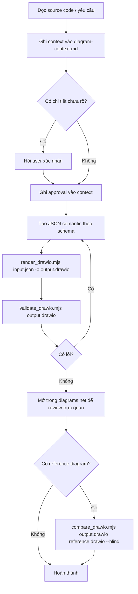
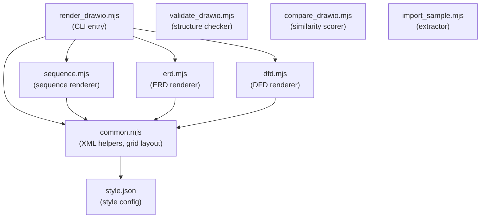

# 📐 drawio-diagrams — Skill Deep-Dive Reference

> [!NOTE]
> Tài liệu này là bản review toàn diện skill `drawio-diagrams`, bao gồm kiến trúc, từng script, JSON schema, workflow, giới hạn, và hướng mở rộng.

---

## 1. Tổng quan

| Thuộc tính | Giá trị |
|---|---|
| **Tên skill** | `drawio-diagrams` |
| **Mô tả** | Chuyển source code hoặc mô tả nghiệp vụ thành file `.drawio` chỉnh sửa được |
| **Loại đầu ra** | XML `.drawio` (diagrams.net / draw.io format) |
| **Đầu vào** | JSON semantic (sequence / erd / dfd) hoặc generic cells JSON |
| **Runtime** | Node.js ≥ 16.6.0 (khuyến nghị LTS 24.x) |
| **Phụ thuộc npm** | **Không có** — chỉ dùng built-in Node.js modules |
| **Xuất ảnh** | Tùy chọn — cần draw.io Desktop CLI cài riêng |
| **License** | MIT |

### Cấu trúc thư mục

```
drawio-diagrams-skill/
├── SKILL.md                    ← Entry point cho agent
├── README.md                   ← Hướng dẫn người dùng
├── rules/
│   └── diagrams.md             ← Quy tắc ký hiệu và giới hạn renderer
├── templates/
│   └── diagram-context.md      ← Template ghi nhận context của dự án
├── examples/
│   ├── sequence.json           ← Ví dụ sequence diagram
│   ├── erd.json                ← Ví dụ ERD
│   └── dfd.json                ← Ví dụ DFD
├── scripts/
│   ├── render_drawio.mjs       ← CLI chính: JSON → .drawio
│   ├── validate_drawio.mjs     ← CLI kiểm tra cấu trúc .drawio
│   ├── compare_drawio.mjs      ← CLI so sánh hai file .drawio
│   ├── import_sample.mjs       ← CLI trích xuất cells từ .drawio sang JSON
│   ├── export.ps1              ← PowerShell: xuất PNG/SVG (cần CLI riêng)
│   ├── common.mjs              ← Module dùng chung: XML helpers, grid layout
│   ├── sequence.mjs            ← Module renderer Sequence
│   ├── erd.mjs                 ← Module renderer ERD
│   ├── dfd.mjs                 ← Module renderer DFD
│   └── style.json              ← Cấu hình style (font, màu, shape)
└── out/                        ← Output (git-ignored)
```

---

## 2. Workflow chuẩn (Agent Protocol)



> [!IMPORTANT]
> Luôn giữ file context (`diagram-context.md`) **trong dự án của user**, không phải trong thư mục skill. Reference diagram là read-only — không sửa đổi.

---

## 3. Script Reference Chi Tiết

### 3.1 `render_drawio.mjs` — CLI chính

**Mục đích:** Nhận JSON đầu vào, dispatch sang renderer phù hợp, xuất file `.drawio`.

```sh
node scripts/render_drawio.mjs input.json [-o output.drawio]
```

**Logic dispatch:**
```
JSON có trường "elements" → renderGeneric()   (generic cell mode)
JSON type = "sequence"    → renderSequence()
JSON type = "erd"         → renderErd()
JSON type = "dfd"         → renderDfd()
Không khớp               → throw Error
```

**Lưu ý quan trọng:**
- Tự động strip BOM UTF-8 khi đọc file
- Tên output mặc định: thay `.json` bằng `.drawio`
- Luôn dùng **đường dẫn riêng** cho input và output (không ghi đè nhau)
- Ghi thư mục output tự động (recursive mkdir)

---

### 3.2 `validate_drawio.mjs` — Kiểm tra cấu trúc

**Mục đích:** Phân tích cấu trúc XML của `.drawio`, báo cáo các vấn đề.

```sh
node scripts/validate_drawio.mjs output.drawio
```

**Các kiểm tra thực hiện:**

| Kiểm tra | Mô tả |
|---|---|
| **balanced** | Tags XML mở/đóng cân bằng |
| **duplicateIds** | Danh sách ID bị trùng |
| **missingSource** | Edge thiếu source endpoint hợp lệ |
| **missingTarget** | Edge thiếu target endpoint hợp lệ |
| **overlapPairs** | Cặp vertex chồng lấp (overlap > 20%, < 80%) — bỏ qua với sequence diagram |
| **shapeCount** | Tổng số vertex |
| **edgeCount** | Tổng số edge |
| **ids** | Tổng số ID duy nhất |

**Output JSON mẫu (pass):**
```json
{
  "file": "out/sequence.drawio",
  "balanced": true,
  "duplicateIds": [],
  "missingSource": [],
  "missingTarget": [],
  "overlapPairs": [],
  "shapeCount": 15,
  "edgeCount": 4,
  "ids": 21
}
```

**Exit code:** `0` = pass, `1` = có vấn đề. Script có thể export `inspect(file)` để dùng trong code khác.

> [!WARNING]
> Validator **không** kiểm tra ngữ nghĩa domain, không phải full UML validator, và bỏ qua overlap cho sequence diagram (vì lifeline bars chồng nhau là bình thường).

---

### 3.3 `compare_drawio.mjs` — So sánh hai diagram

**Mục đích:** So sánh diagram được tạo ra với một reference, cho điểm tương đồng.

```sh
node scripts/compare_drawio.mjs generated.drawio reference.drawio [--blind]
```

**Hai chế độ:**

#### Chế độ `--blind` (so sánh cấu trúc, không dùng label)
Dùng khi reference chứa thông tin nhạy cảm.

Output:
```json
{
  "mode": "blind",
  "generatedCounts": { "participants": 2, "messages": 3, "fragments": {"alt": 1} },
  "referenceCounts": { ... },
  "scores": {
    "participants": 1,
    "messages": 0.9,
    "fragments": { "alt": 1 },
    "orderedPairLcs": 0.85,
    "style": { "fontFamily": 1, "fontSize": 1, "fillColor": 0, ... }
  }
}
```

**`orderedPairLcs`**: LCS (Longest Common Subsequence) của các cặp `(source_participant_index, target_participant_index)` — đo thứ tự message có đúng không.

#### Chế độ roundtrip (mặc định)
So sánh label, số shapes, edges, styles.

Output:
```json
{
  "mode": "roundtrip",
  "scores": {
    "shapes": 0.95,
    "edges": 1.0,
    "labels": 0.8,
    "style": { ... }
  }
}
```

> [!NOTE]
> Điểm số là **tư vấn**, không phải ngưỡng pass/fail. Self-comparison chỉ để test lệnh, không chứng minh fidelity.

---

### 3.4 `import_sample.mjs` — Trích xuất từ .drawio

**Mục đích:** Đọc file `.drawio` (kể cả compressed) và xuất JSON dạng generic cells.

```sh
node scripts/import_sample.mjs input.drawio output.json sequence|erd|dfd
```

Hỗ trợ:
- `.drawio` dạng plain XML
- `.drawio` có nội dung compressed (base64 + deflate/inflateRaw)

Output JSON có dạng `{ type, title, elements[], fragments[] }`.

> [!CAUTION]
> JSON output có thể chứa label và metadata nhạy cảm từ file gốc. Review kỹ trước khi chia sẻ.

---

### 3.5 `export.ps1` — Xuất PNG/SVG

**Mục đích:** Gọi draw.io Desktop CLI để render ảnh.

```powershell
powershell -File scripts/export.ps1 -InputFile out/sequence.drawio -OutputDir out/export -Format png
```

| Tham số | Bắt buộc | Mặc định | Giá trị hợp lệ |
|---|---|---|---|
| `-InputFile` | ✅ | — | đường dẫn tới `.drawio` |
| `-OutputDir` | ✅ | — | thư mục output |
| `-Format` | ❌ | `png` | `png`, `svg` |

**Yêu cầu:** `drawio` phải có trên PATH. Nếu không có, script in hướng dẫn và exit code 0 (không crash) — cần tự kiểm tra file output có tồn tại không.

---

### 3.6 `common.mjs` — Module dùng chung

Các hàm xuất:

| Hàm | Chữ ký | Mô tả |
|---|---|---|
| `esc(v)` | `(any) → string` | Escape XML: `&`, `<`, `>`, `"` |
| `vertex(id, value, style, x, y, w, h, parent)` | `→ string` | Tạo XML `<mxCell>` dạng vertex |
| `edge(id, source, target, value, style, parent)` | `→ string` | Tạo XML `<mxCell>` dạng edge |
| `docXml(title, cells[], page)` | `→ string` | Bọc cells vào XML document đầy đủ |
| `loadStyle()` | `→ object` | Đọc `style.json` |
| `writeOut(path, xml)` | `→ void` | Ghi file, tạo thư mục nếu chưa có |
| `layoutGrid(items, cols, cellW, cellH)` | `→ items[]` | Gán `x`, `y` theo lưới đều |
| `renderGeneric(d)` | `→ cells[]` | Render generic element list |

**`docXml` output structure:**
```xml
<?xml version="1.0" encoding="UTF-8"?>
<mxfile host="app.diagrams.net" type="device">
  <diagram id="diagram1" name="{title}">
    <mxGraphModel page="1" pageWidth="1200" pageHeight="800" grid="1" gridSize="10">
      <root>
        <mxCell id="0"/>
        <mxCell id="1" parent="0"/>
        {cells...}
      </root>
    </mxGraphModel>
  </diagram>
</mxfile>
```

---

## 4. Renderer Chi Tiết

### 4.1 `sequence.mjs` — renderSequence(data, style)

**Thuật toán layout (2 pass):**

**Pass 1 — `plan()`**: Duyệt cây items (messages + fragments), tính `y` tích lũy:
- Message: +58px
- Fragment header: +32px
- Branch separator: +30px
- Fragment footer: +12px

**Pass 2 — `draw()`**: Sinh XML cells từ kết quả plan:

| Element | Cells được tạo |
|---|---|
| Participant | `vertex` với `shape=umlLifeline` |
| Lifeline | `vertex` dạng dải dọc `width=1` |
| Message | 2 `vertex` transparent (`msg_from_N`, `msg_to_N`) + 1 `edge` |
| Fragment box | `vertex` với `shape=umlFrame` |
| Branch separator | 2 transparent vertex + 1 dashed edge |
| Guard label | `vertex` dạng `text` |

**Các loại message:**
- `sync`: `endArrow=block; dashed=0`
- `async`: `endArrow=block; dashed=0` ← **giống sync** (hạn chế đã biết)
- `return`: `endArrow=open; dashed=1`

**Các loại fragment:** `alt`, `opt`, `loop`, `par`

**Ví dụ JSON đầy đủ:**
```json
{
  "type": "sequence",
  "title": "Submit an order",
  "participants": [
    { "id": "customer", "label": "Customer" },
    { "id": "service", "label": "Order service" }
  ],
  "messages": [
    { "order": 1, "from": "customer", "to": "service", "label": "Submit order", "kind": "sync" }
  ],
  "fragments": [
    {
      "kind": "alt",
      "order": 2,
      "branches": [
        {
          "guard": "items available",
          "messages": [
            { "order": 1, "from": "service", "to": "customer", "label": "Order accepted", "kind": "return" }
          ]
        },
        {
          "guard": "items unavailable",
          "messages": [
            { "order": 1, "from": "service", "to": "customer", "label": "Order rejected", "kind": "return" }
          ]
        }
      ]
    }
  ]
}
```

---

### 4.2 `erd.mjs` — renderErd(data, style)

**Layout:** Grid vuông (`ceil(sqrt(N))` cột), tính chiều cao entity theo số attributes.

**Entity:** `shape=table`, label là chuỗi ghép `"EntityName\nattr1\nattr2..."`.

**Relationship:** Hard-coded `startArrow=ERzeroToMany; endArrow=ERone` — **không thể tùy chỉnh cardinality**.

**Ví dụ JSON:**
```json
{
  "type": "erd",
  "title": "Synthetic catalog",
  "entities": [
    {
      "name": "Product",
      "attributes": [
        { "name": "id", "type": "integer", "key": "PK" },
        { "name": "name", "type": "text" }
      ]
    },
    {
      "name": "OrderItem",
      "attributes": [
        { "name": "id", "type": "integer", "key": "PK" },
        { "name": "product_id", "type": "integer", "key": "FK" }
      ]
    }
  ],
  "relations": [
    { "from": "OrderItem", "to": "Product", "name": "references" }
  ]
}
```

**Cell counts (ví dụ trên):** 2 entity vertices + 1 relation edge = 3 cells.

---

### 4.3 `dfd.mjs` — renderDfd(data, style)

**Layout:** Grid (`layoutGrid` từ common.mjs), `ceil(sqrt(N))` cột, cell 220×160px.

**Các loại node và shape tương ứng:**

| kind | Shape draw.io | Ý nghĩa |
|---|---|---|
| `process` | `ellipse` | Xử lý/tiến trình |
| `dataStore` | `partialRectangle` | Kho dữ liệu (dạng hai ngang) |
| `externalEntity` | `default` (rectangle) | Thực thể ngoài hệ thống |

**Flow (edge):** `endArrow=block; strokeColor=#000000`

**Ví dụ JSON:**
```json
{
  "type": "dfd",
  "title": "Catalog lookup",
  "nodes": [
    { "id": "reader", "kind": "externalEntity", "label": "Reader" },
    { "id": "search", "kind": "process", "label": "1. Search catalog" },
    { "id": "catalog", "kind": "dataStore", "label": "D1 Catalog" }
  ],
  "flows": [
    { "from": "reader", "to": "search", "label": "Search terms" },
    { "from": "search", "to": "catalog", "label": "Catalog query" },
    { "from": "catalog", "to": "search", "label": "Matching products" },
    { "from": "search", "to": "reader", "label": "Search results" }
  ]
}
```

**Cell counts:** 3 nodes + 4 flows = 7 cells.

---

## 5. Schema JSON Đầy Đủ

### Sequence

```
{
  type: "sequence",
  title?: string,
  page?: { width: number, height: number },
  participants: [
    { id: string, label?: string }
    | string   // shorthand: id = label
  ],
  messages?: [
    { order: number, from: string, to: string, label?: string,
      kind: "sync" | "async" | "return" }
  ],
  fragments?: [
    { kind: "alt" | "opt" | "loop" | "par", order: number,
      branches: [
        { guard?: string,
          messages?: [...],
          fragments?: [...] }  // nested fragments OK
      ]
    }
  ]
}
```

### ERD

```
{
  type: "erd",
  title?: string,
  entities: [
    { name: string,
      attributes?: [
        { name: string, type?: string, key?: "PK" | "FK" | string }
        | string  // shorthand
      ]
    }
  ],
  relations?: [
    { from: string, to: string, name?: string }
  ]
}
```

### DFD

```
{
  type: "dfd",
  title?: string,
  nodes: [
    { id: string, kind: "process" | "dataStore" | "externalEntity", label: string }
  ],
  flows: [
    { from: string, to: string, label?: string }
  ]
}
```

### Generic (import/manual)

```
{
  elements: [
    { attrs: { id, value, style, parent, ... },
      vertex?: true,
      edge?: true,
      geometry: { x, y, width, height, relative, points: [...] }
    }
  ]
}
```

---

## 6. Cấu hình Style (`style.json`)

Style phân theo từng loại diagram. Các field được renderer **thực sự đọc**:

### Sequence
| Field | Nơi dùng |
|---|---|
| `sequence.fontSize` | Font size chung cho lifeline, message, fragment |
| `sequence.participant.strokeColor` | Màu viền lifeline và dải dọc |
| `sequence.fragment.shape` | Shape của frame (mặc định `umlFrame`) |
| `sequence.fragment.fillColor` | Nền fragment |
| `sequence.fragment.strokeColor` | Viền fragment |
| `sequence.fragment.strokeWidth` | Độ dày viền |
| `sequence.fragment.separatorStyle` | Style dashed line giữa các branch |
| `sequence.fragment.guardFontSize` | Font size guard label |

### ERD
| Field | Nơi dùng |
|---|---|
| `erd.fontSize` | Font size entity |
| `erd.entity.fillColor` | Nền entity box |
| `erd.entity.strokeColor` | Viền entity box |

> [!TIP]
> Nhiều field trong `style.json` (như `activation`, `message.shape`, `usecase.*`) **chưa được renderer đọc** — chỉ là dữ liệu tĩnh để tham khảo hoặc mở rộng sau.

### DFD
| Field | Nơi dùng |
|---|---|
| `dfd.fontSize` | Font size chung |
| `dfd.process.fillColor` | Nền process |
| `dfd.process.strokeColor` | Viền process |
| `dfd.dataStore.fillColor` | Nền data store |
| `dfd.externalEntity.fillColor` | Nền external entity |

---

## 7. Template `diagram-context.md`

Dùng để agent ghi nhận tất cả context trước khi render. File này phải lưu **trong dự án của user**.

```
## Scope          — Tên project, nguồn code, loại diagram, ngôn ngữ label
## Actors         — Actors, quyền, hành động, nguồn chứng cứ
## Entities       — Entities, attributes, keys, cardinality, nguồn chứng cứ
## Flows          — Trigger, participants, messages, guards, errors
## Data flows     — Level DFD, external entities, processes, stores
## Assumptions    — Mọi suy luận chưa có chứng cứ
## Approval       — Scope đã được user xác nhận
## Outputs        — Đường dẫn JSON, .drawio, validation, visual review notes
```

---

## 8. Trạng thái Diagram Types

| Loại | Trạng thái | Chi tiết |
|---|---|---|
| **Sequence** | ✅ Supported | Participants, sync/return/async messages, alt/opt/loop/par fragments, nested fragments |
| **ERD** | 🔬 Experimental | Entity + attributes, named relations. Cardinality cố định zero-to-many → one |
| **DFD** | 🔬 Experimental | Process/dataStore/externalEntity nodes, labeled flows. Layout cơ bản, không tự cân bằng level |
| **Use case** | ❌ Không có renderer | Phải layout cell thủ công |
| **Activity** | ❌ Không có renderer | Phải layout cell thủ công |

---

## 9. Giới hạn Đã Biết

| Vấn đề | Ảnh hưởng |
|---|---|
| Layout cơ bản | Label dài, self-message, crossing, fragment lớn có thể cần chỉnh tay |
| Async = Sync style | `kind: "async"` dùng cùng mũi tên solid với `sync` |
| ERD cardinality cố định | `ERzeroToMany → ERone` — không thể chỉnh trong JSON |
| ERD PK/FK boolean bị bỏ | Metadata boolean không dùng; chỉ dùng string `key` để hiển thị |
| `par` không mô phỏng concurrency | Chỉ là visual grouping |
| DFD level balancing | Phải kiểm tra tay |
| Import không roundtrip hoàn hảo | Geometry và fragment membership có thể mất |
| Compressed/multipage `.drawio` | Import/compare hỗ trợ hạn chế |
| Page size cố định | Default 1200×800; cần chỉnh tay cho diagram lớn |
| Validator không check UML đầy đủ | Chỉ check cấu trúc XML, không check semantic |

---

## 10. Các Lệnh Quick-Start

```sh
# Render 3 ví dụ
node scripts/render_drawio.mjs examples/sequence.json -o out/sequence.drawio
node scripts/render_drawio.mjs examples/erd.json      -o out/erd.drawio
node scripts/render_drawio.mjs examples/dfd.json      -o out/dfd.drawio

# Validate
node scripts/validate_drawio.mjs out/sequence.drawio
node scripts/validate_drawio.mjs out/erd.drawio
node scripts/validate_drawio.mjs out/dfd.drawio

# Import từ .drawio có sẵn
node scripts/import_sample.mjs out/sequence.drawio out/imported.json sequence

# Render lại từ imported JSON
node scripts/render_drawio.mjs out/imported.json -o out/imported.drawio

# So sánh cấu trúc (blind mode)
node scripts/compare_drawio.mjs out/sequence.drawio out/sequence.drawio --blind

# Xuất PNG (cần drawio CLI)
powershell -File scripts/export.ps1 -InputFile out/sequence.drawio -OutputDir out/export -Format png
```

**Expected cell counts (ví dụ):**
- sequence: 19 cells (15 vertices + 4 edges)
- erd: 3 cells (2 vertices + 1 edge)
- dfd: 7 cells (3 vertices + 4 edges)

---

## 11. Quy tắc An toàn

- ❌ Không lưu context dự án, source code private, credentials vào trong thư mục skill
- ❌ Không phân phối reference diagram người dùng cung cấp
- ❌ Không sửa reference diagram (read-only)
- ✅ Dùng UTF-8 không BOM; khi ghi qua PowerShell dùng `[IO.File]::WriteAllText(path, text, [Text.UTF8Encoding]::new($false))`
- ✅ Chạy `node --check` sau mỗi lần sửa `.mjs`
- ✅ Lưu generated JSON, diagram, export vào đường dẫn output riêng

---

## 12. Mở Rộng & Tùy Chỉnh

### Thêm loại diagram mới
1. Tạo `scripts/mytype.mjs` export `renderMytype(data, style)`
2. Thêm `import` và dispatch vào `render_drawio.mjs`
3. Thêm style section vào `style.json`
4. Thêm example vào `examples/`
5. Cập nhật `rules/diagrams.md` và `README.md`

### Thay đổi style
Chỉnh `scripts/style.json`. Các field thực sự được đọc đã liệt kê ở Mục 6.

### Thay đổi cardinality ERD
Hiện tại hard-coded trong `erd.mjs` dòng cuối:
```js
`edgeStyle=orthogonalEdgeStyle;html=1;startArrow=ERzeroToMany;endArrow=ERone;strokeColor=#000000;`
```
Cần sửa trực tiếp hoặc thêm field `cardinality` vào schema để dispatch style.

### Thay đổi page size
Truyền field `page` vào JSON input:
```json
{ "type": "sequence", "page": { "width": 2000, "height": 1200 }, ... }
```

---

## 13. Kiến trúc Phụ Thuộc Module



---

## 14. Ghi Chú Quan Trọng cho Agent

1. **Không phát minh chứng cứ** — chỉ dùng thông tin có trong source code và requirements.
2. **Hỏi trước, render sau** — mọi chi tiết domain chưa rõ phải có approval trước khi vẽ.
3. **Approval dùng lại được** — cùng một scope đã được xác nhận thì không hỏi lại.
4. **Validation là cần thiết, không đủ** — pass validate không đồng nghĩa với diagram đúng domain logic; phải mở diagrams.net để xem trực quan.
5. **Use case và Activity** — renderer chưa có; phải thông báo user và hướng dẫn layout thủ công.
6. **Script paths là relative** — tất cả lệnh chạy từ thư mục gốc skill (hoặc `cd` vào đó trước).
